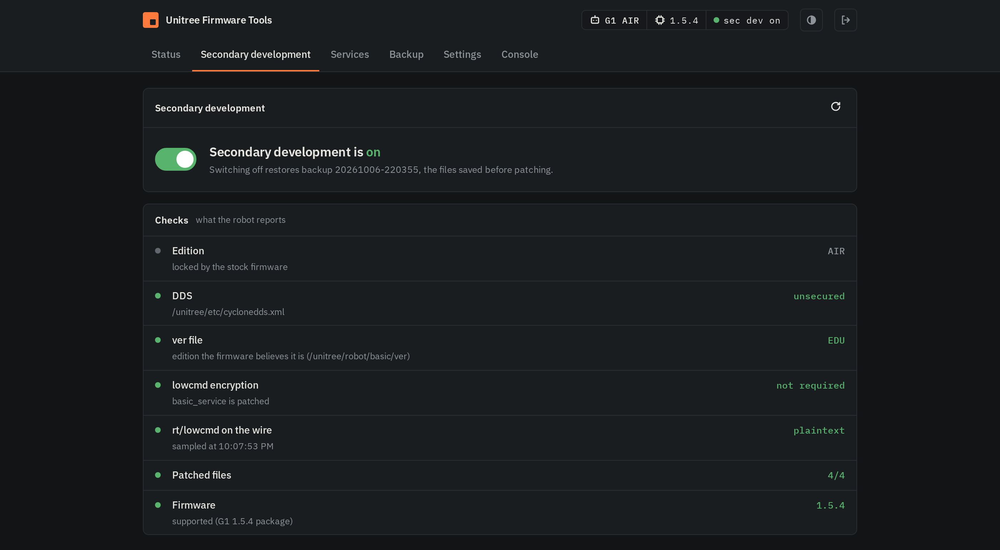

# Unitree Firmware Tools

Unitree's **AIR** and **PRO** robots ship with **secondary development locked**: you can't send
low-level commands or drive the robot from the SDK. **This tool unlocks it.** It runs on the robot,
flips secondary development on with one switch, keeps backups so you can always go back, and
installs a **guardian** failsafe so you never get locked out.



> ⚠️ **Root access is required first.** This tool configures a robot that is **already
> jailbroken (root)**; it does *not* jailbreak the robot for you. For the jailbreak guide, see the
> **RoboLegion Discord** → [robolegion.com](https://robolegion.com).

## ⚠️ Disclaimer

Modifying robot firmware carries risk. **Use this only on a robot you personally own**, entirely
**at your own risk**. The author accepts **no responsibility for any damage, injury, or loss**
resulting from its use.

## Supported robots

| Robot | Firmware versions |
|---|---|
| **R1** | 1.4.2 |
| **G1** | 1.4.0, 1.4.5, 1.5.3, 1.5.4 |
| **Go2** | 1.1.2, 1.1.3, 1.1.4, 1.1.6, 1.1.7, 1.1.11, 1.1.14, 1.1.15 |

AIR and PRO editions. EDU robots already have secondary development, so the tool shows it as on
and leaves them alone. A firmware that isn't listed is often still supported: the tool fingerprints
the robot's service binaries and picks the matching package when Unitree re-shipped the same files.
If nothing matches, it refuses rather than guesses.

## Features

- **Secondary development on/off** with one switch. The tool reads the robot's real model, edition
  and firmware, downloads the matching md5-verified package, stops the stack the same way an OTA
  does, backs up every original, installs and re-verifies. Off restores the backup (or the factory
  files). A power-cycle finishes either change.
- **Live checks**: DDS security, the edition the firmware believes it is, whether low-level commands
  must be encrypted, and a live sample of `rt/lowcmd` on the wire.
- **Guardian failsafe**: keeps SSH alive, keeps root login working across OTA updates, and brings
  WiFi back if the Unitree stack fails to boot. Installed on first run, switchable in Settings.
- **Services**: start and stop any Unitree service.
- **Backup**: download the boot-critical flash areas (loader, u-boot, boot, identity) as a zip.
- **Console**: a root shell in the browser.
- **Offline install** from a local package: `./start.sh --cli --package <dir|zip>`.

## Run

Install on the robot (you're root after the jailbreak):

```bash
mkdir -p /unitree/dev && cd /unitree/dev
git clone https://github.com/legion1581/unitree_firmware_tools.git
cd unitree_firmware_tools && pip install -r requirements.txt
./start.sh
```

Or push it from your PC with `ROBOT=root@192.168.123.161 ./deploy.sh --run`.

`./start.sh` auto-detects the robot, installs the web UI as a service that starts at boot, and
prints its address:

```
    http://192.168.123.161:8080/        # open this on any device on the same network
```

Log in with the password **`robolegion`** and change it under **Settings**. Forgot it?
`./start.sh --reset-password` on the robot. Other options:

```bash
./start.sh --port 8080              # pick the port
./start.sh --platform G1            # force the platform instead of auto-detect
./start.sh --cli                    # terminal menu instead of the web UI
```

## Before an official firmware update

**Restore first.** Switch secondary development **off** before running an OTA update: patched
binaries can make the update fail. Update, then switch it back on. The guardian keeps your root
password and SSH working across the update, and brings WiFi up if the stack doesn't come back.

## G1 / R1: wired connection required

On the **G1** and **R1** the SDK/DDS traffic only works over **Ethernet**, not WiFi. The robot is
reachable at **192.168.123.161** from the wired PC. The R1 has no spare jack: add one with a small
**JST → RJ45 adapter** on the empty Lidar port, see **[docs/R1_ETHERNET.md](docs/R1_ETHERNET.md)**.

### Thanks
To the RoboLegion community! Visit [robolegion.com](https://robolegion.com) for info and support.

### Support
If you like this project, consider buying me a coffee:

<a href="https://www.buymeacoffee.com/legion1581" target="_blank"></a>
